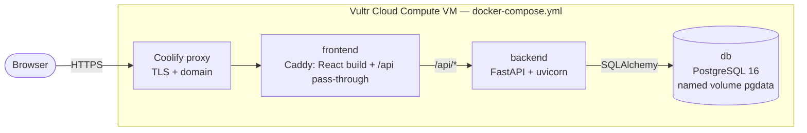

# Architecture



- Only `frontend:80` is reachable from outside (through Coolify). `backend` and `db` live on the private compose network.
- `GET /api/health` runs `SELECT 1`; Docker uses it as the backend healthcheck and the frontend polls it every 5 s.
- Every request gets an `X-Request-ID`; logs are one JSON object per line tagged with it.
- Errors always return `{"error": {"code", "message"}}`.
- Agents (`backend/app/agents/`) get typed input, return typed output and never touch the database.
  The runner checks the caller's permission, retries invalid or timed-out model replies twice (2 s, 8 s),
  and writes an `agent_tasks` + `audit_logs` row for every agent call and every tool call.
- Invoice intake: upload (type checked by content, max 10 MB) → `read_upload` → Invoice Processor (LLM
  extracts fields) → `get_po` → match by vendor, currency and amount (code) → duplicate check (code) →
  `save_invoice` or `flag_anomaly`. Duplicates are recorded in `invoice_anomalies`, never inserted.
- Workflow B (Supplier Payment Verification) is a plain state machine (`backend/app/orchestrator/`):

  ```mermaid
  flowchart LR
      P1[P1 load PO] --> F2[F2 match invoice to PO]
      F1[F1 extract invoice - LLM] --> F2
      F2 -- mismatch --> F3[F3 discrepancy report]
      F2 -- matched --> A1
      F3 --> A1{{A1 manager approval}}
      A1 -- approved --> F4[F4 submit payment]
      A1 -- rejected --> V1
      F4 --> V1[V1 verification - rules only]
  ```

  A step runs only when the steps it depends on have finished; `when` conditions skip F3 / F4.
  Steps run in a FastAPI background task and the UI polls every 5 s. A1 always pauses the run
  (`waiting_approval`) until a finance manager approves or rejects in the Approval Center; nobody can
  decide their own request. A failed step pauses the run as `failed`; Retry re-runs only failed
  steps with their stored inputs. Payments are created only for an approved request of that invoice.
- Sales: the Lead Qualifier gets only company, email domain, status, priority, value and notes (no
  contact name or full email) and must return hot/warm/cold, a reason of 20+ words and the fields it cited.
- Lists use cursor pagination: `?limit=&cursor=`, newest first.
- Schema is managed by Alembic (`backend/alembic/`) and applied on backend start-up. `audit_logs` is
  append-only: a PostgreSQL trigger rejects `UPDATE` and `DELETE`.
- Auth: `POST /api/auth/login` returns an HS256 JWT valid 8 h (bcrypt password hashes). Each user has one
  role and one department. Department routers use one guard:

  | Role | Own department | Other departments |
  |---|---|---|
  | employee | read + write | none |
  | manager | read + write | read |
  | executive | read | read |
  | admin | read + write | read + write |
