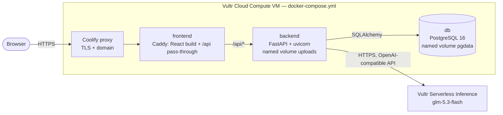

# Architecture



- Only `frontend:80` is reachable from outside (through Coolify). `backend` and `db` live on the private compose network.
  Uploaded files are stored on the `uploads` volume, outside the web root.
- `GET /api/health` runs `SELECT 1`; Docker uses it as the backend healthcheck.
- Every request gets an `X-Request-ID`; logs are one JSON object per line tagged with it.
- Errors always return `{"error": {"code", "message"}}`.
- Agents (`backend/app/agents/`) get typed input, return typed output and never touch the database.
  The runner checks the caller's permission, retries invalid or timed-out model replies twice (2 s, 8 s),
  and writes an `agent_tasks` + `audit_logs` row for every agent call and every tool call.

  | Agent | Department | Uses the LLM to | Time limit |
  |---|---|---|---|
  | Aura Router | caller's own | pick one route from a fixed list | 10 s |
  | Lead Qualifier | sales | rate a lead hot/warm/cold with a reason | 20 s |
  | Outreach Writer | sales | draft a first email to a qualified lead | 30 s |
  | Invoice Processor | finance | extract invoice fields | 60 s |
  | Resume Parser | hr | extract skills, years, education | 30 s |
  | Resume Screener | hr | quote evidence for each requirement | 30 s |
  | Interview Invite Writer | hr | draft an interview invitation listing code-picked times | 30 s |
  | Ticket Investigator | support | classify a ticket; explain it from the customer's orders | 30 s |
  | Vendor Comparator | procurement | explain the code-computed ranking | 20 s |
  | Payment Reminder Writer | finance | draft a reminder for an overdue customer order | 30 s |
  | Supplier Follow-up Writer | procurement | draft a chase email for a late purchase order | 30 s |
  | Verification Agent | finance | — (rules only) | 5 s |
- Uploads (`services/uploads.py`) are refused before anything is stored if the agents could not read
  them: only PDF, CSV and TXT up to 10 MB, type checked by content (magic bytes), images and Word files
  get a message saying what to do, and a PDF with no text layer (a scan) is refused with its reason, so
  no workflow starts on a file that cannot succeed.
- Invoice intake: upload (type checked by content, max 10 MB) → `read_upload` → Invoice Processor (LLM
  extracts fields) → `get_po` → match by PO status (must be approved), vendor, currency and amount
  (code) → duplicate check (code) → `save_invoice` or `flag_anomaly`. `app/safety.py` (code, no model)
  scans the invoice text for lines aimed at the AI; findings are audited (`security.instruction_text_found`)
  and shown as a prompt-injection warning on the run and on the approval card. Duplicates are recorded in `invoice_anomalies`, never inserted.
- Receivables (money owed to us): an unpaid customer order is due on its order date + the customer's
  terms (`net_30`). Code computes `days_overdue` and puts a customer with an open refund, billing or legal
  ticket on hold (never chased). For an overdue order the Payment Reminder Writer drafts a reminder that
  must quote the order number; it goes through the shared approve-then-send path (finance manager).
- Workflow B (Supplier Payment Verification) is a plain state machine (`backend/app/orchestrator/`):

  ```mermaid
  flowchart LR
      P1[P1 load PO] --> F2[F2 match invoice to PO]
      F1[F1 extract invoice - LLM] --> F2
      F2 -- mismatch --> F3[F3 discrepancy report]
      F2 -- matched --> A1
      F3 --> A1{{A1 manager approval}}
      A1 -- approved --> F4[F4 submit payment]
      A1 -- rejected --> V1
      F4 --> V1[V1 verification - rules only]
  ```

  A step runs only when the steps it depends on have finished; `when` conditions skip F3 / F4.
  Steps run in a FastAPI background task and the UI polls every 5 s. A1 always pauses the run
  (`waiting_approval`) until a finance manager (or an admin) approves or rejects in the Approval Center; nobody can
  decide their own request. A failed step pauses the run as `failed`; Retry re-runs only failed
  steps with their stored inputs. Payments are created only for an approved request of that invoice.
- Sales: the Lead Qualifier gets only company, email domain, status, priority, value and notes (no
  contact name or full email) and must return hot/warm/cold, a reason of 20+ words and the fields it cited.
  For a qualified lead the Outreach Writer drafts a first email from the same facts; code rejects drafts
  with links, placeholders, email addresses or greetings, then adds "Hi <first name>," and the rep's
  signature. The rep edits and asks for approval (`send_email`, sales manager); only an approved email
  is sent (`app/mailer/`, Resend over HTTPS) by the `mailer → send_email` tool. A failed send is kept as
  `failed` with the provider's reason and can be retried without a new approval. `EMAIL_REDIRECT_TO`
  sends every email to one demo inbox.
- HR: the Resume parser extracts skills, years and education at upload. The Resume Screener only returns
  evidence (requirement + exact quote); code rejects any quote not found in the resume and computes the
  score: 70 × (skills with evidence ÷ required skills) + 30 × min(years ÷ minimum years, 1).
- Interviews: a candidate screened 50+ for an open job can be invited. `app/scheduling.py` (code) picks the
  first free 45-minute start (10, 11, 14, 15 or 16:00 PKT) on each of the next three working days, skipping
  times already held. The slots are held with the draft (`interview_slots`); the Interview Invite Writer must
  copy every time verbatim or the draft is retried. An HR manager approves; a rejected invite frees its times.
- Support: new tickets are saved, then classified (category + urgency). Investigation sends the customer's
  last 20 orders; code rejects any cited order number that is not theirs. Escalating a refund or legal ticket
  creates an approval for a support manager; approved → resolved, rejected → reopened. Replies are drafts only.
- Procurement: vendors quote a unit price per request. Code ranks them: 50% price + 25% lead time + 25%
  on-time rate, each relative to the best offer (ties: cheaper, then name). The Vendor Comparator only
  explains the result and must name the winner. A procurement manager approves the request; every PO
  (from a request or created directly) waits in the Approval Center as `pending_approval`.
  Approval starts delivery tracking: `ordered_on` = today, `expected_delivery` = today + the vendor's
  lead time. Code computes `delivery_status` (on_track / late / delivered) and `days_late`; the buyer
  marks delivery or records a new date the supplier confirmed. For a late order the Supplier Follow-up
  Writer drafts a chase (it must quote the PO number); it goes through the same approve-then-send path
  as sales emails (`services/outbound.py`), approved by a procurement manager.
- Dashboard (managers, executives, admins): KPIs and charts are SQL aggregates; the feed is the latest 20
  audit events. `/api/dashboard/overview` feeds the panels in one read: a hiring board (each candidate in
  the furthest stage their records prove: applied → screened → invite pending → invite sent), the deal
  board (leads per status, win rate, won this quarter vs the `SALES_QUARTER_TARGET` setting), open
  tickets by urgency, money stuck in invoices / customer payments / late deliveries, and an insights line
  worded by code from those numbers (no model). The top-bar search (`/api/search`) applies the same
  read rule as every page, so an employee only finds their own department's records. The Command Center lists every agent/tool call and retries failed workflow runs.
- Aura chat: the Aura Router picks one route from a fixed list and names the target; code finds the record,
  checks the user's rights and runs the department agent, so Aura can never do more than the user can.
- "Why?" drawer (`services/explain.py`, `GET /api/explain/...`): read-only, same department read rule as
  the pages. It rebuilds an agent's input with the same function the service used and looks up
  `agent_tasks` rows with the same `input_hash` (runs use `execution_id`), so a match proves the input
  shown is the one the model saw. Output comes from the stored result, rules from code, people from
  `audit_logs`. Categories set by a person (seed data) are not presented as AI output.
- Aura brief and quick actions (`services/brief.py`): code collects the facts for the reader (dashboard
  counts, plus which pending decisions are theirs and which belong to another manager) and a focus line
  from their role. The Brief Writer only words them; `check_brief` rejects a draft with any number that
  no fact contains, so the runner retries and finally the code-written brief is kept. The panel shows the
  code version at once (`?writer=code`) and swaps in the model's when it arrives. Quick actions are built
  from real records (newest open job, unrated lead, pending purchase request, most urgent ticket) and send
  Aura a normal chat message. Voice input uses the browser's own speech recognition (Chrome, Edge);
  only the recognised text reaches the backend.
- Demo data: `python -m app.seed` creates the demo company idempotently (natural keys: email, vendor name, PO
  number, …). AI results are not pre-filled; they come from running the agents.
- The frontend container serves `index.html` with `Cache-Control: no-cache` and hashed `/assets/*` as immutable, so a
  new release is picked up on the next page load.
- Lists use cursor pagination: `?limit=&cursor=`, newest first.
- Schema is managed by Alembic (`backend/alembic/`) and applied on backend start-up. `audit_logs` is
  append-only: a PostgreSQL trigger rejects `UPDATE` and `DELETE`.
- Auth: `POST /api/auth/login` returns an HS256 JWT valid 8 h (bcrypt password hashes). Each user has one
  role and one department. `POST /api/auth/demo-switch` lets a signed-in `@demo.example.com` account get a
  token for another demo account (the guided tour and the "View as" menu use it). The demo accounts share
  one password, so this adds no access; admins and real accounts can neither switch nor be switched to,
  and every switch is audited. Department routers use one guard:

  | Role | Own department | Other departments |
  |---|---|---|
  | employee | read + write | none |
  | manager | read + write | read |
  | executive | read | read |
  | admin | read + write | read + write |
